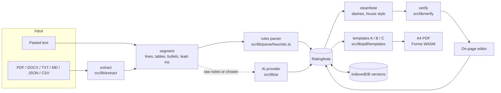

# Architecture

Rating Note Generator turns one source (an uploaded document or pasted text) into an ACER credit rating press release, lets an analyst edit it on the page, checks every figure against the source, and exports a branded A4 PDF in one of three templates. Everything runs in the browser; the site is a static Next.js export on GitHub Pages.

## Design principles

1. **One data model.** Every input becomes a `RatingNote` (`src/lib/note/schema.ts`). The editor, the verifier, the templates and storage all read and write that one object. Nothing downstream ever looks at the raw document again, except the verifier, which compares the note with the source text.
2. **Facts flow one way.** Facts can only enter the note from the source document or from the analyst typing them. Templates and derived views select, reorder and count; the only new numbers they produce are arithmetic on the note's own figures (year-on-year change), labelled as computed.
3. **AI is optional and untrusted.** The rules engine rebuilds ACER-format notes with no AI. When AI drafts prose, its output passes the same deterministic checks as an analyst's edits, and anything it cannot trace is flagged, never silently accepted.
4. **Deterministic over clever.** Parsing, verification, arithmetic and layout are plain functions with unit tests. The only non-deterministic step is the optional AI call.
5. **Static and private by default.** No server holds documents. Notes are saved in the browser (IndexedDB); AI keys stay in the browser (localStorage) and go only to the chosen provider.

## Pipeline



### 1. Extract (`src/lib/extract`)

| Input | How it is read | Output |
| --- | --- | --- |
| PDF | pdf.js text items with positions and font names (`pdf-layout.ts`); drawn table borders from the operator list | lines with bold/italic spans, cells, page rules |
| DOCX | mammoth to HTML, walked into lines and tables | document items |
| TXT / MD / CSV | line parser: `#` headings, `**bold**` lead-ins, bullets, `|` or tab tables | document items |
| JSON | an exported `RatingNote` is imported as is; other JSON is flattened to text | note or items |

Scanned PDFs (no text layer) are rejected with a clear message rather than guessed at.

### 2. Segment (`src/lib/extract/segment.ts`)

Turns PDF layout into a renderer-neutral stream of `DocItem`s: lines (with bold lead-in, bullet flag, vertical gap) and tables. Bordered tables are rebuilt from the drawn grid (rows are bands between horizontal rules, columns come from vertical rules), so multi-line cells stay intact. Borderless tables are rebuilt from column gaps. Running headers, footers and page numbers are removed. Tables that continue across pages are stitched.

### 3. Build the note

- **Rules parser (`src/lib/parse/heuristic.ts`).** Maps items to the ACER structure: title block, instruments table (by heading, or a rating table directly under the title), sections by known headings in either ACER layout (the older "Details of Instruments" format and the newer "Rating Action" format), titled drivers in both "Title- text" and separate-title styles, sensitivities, criteria, footnotes and sources under tables, contacts in rows or columns, and the disclaimer. It only rearranges source text.
- **AI (`src/lib/ai`).** One provider-independent call (Gemini, Groq or Claude) with a fixed system prompt (`prompt.ts`) and a JSON schema. The prompt forbids new facts, rounding and rating changes, and asks the model to list anything missing as `openQuestions` instead of writing filler. Gemini gets the schema as `responseJsonSchema`; Claude uses structured outputs; Groq uses JSON mode. Overloaded models are retried and fall back to sibling models.
- **Engine choice (`src/lib/generate.ts`).** "Automatic" uses the rules engine for anything that already looks like a press release, and AI only for raw material when a key is set. The user can force either.

### 4. Clean (`src/lib/note/style.ts`)

`cleanNote` replaces em and en dashes (ranges become hyphens, asides become commas). `printSafe` runs at render time and maps characters the brand fonts lack (the rupee sign becomes "INR").

### 5. Verify (`src/lib/verify/verify.ts`)

Runs after generation and again, live, on every edit.

| Check | Catches | Severity |
| --- | --- | --- |
| Traceability, figures | any number in the note that is not in the source, including small counts, years and amounts written like "INR1,300" | error |
| Traceability, ratings | any `ACER <symbol>` not in the source | error |
| Names | multi-word proper names the source never mentions | warning |
| Grounding | sentences whose content words are mostly absent from the source | warning |
| Coverage (AI drafts) | figures in the source that the note dropped | info |
| Arithmetic | totals that do not add up; margins that do not match their revenue and profit rows | error / warning |
| Consistency | headline rating different from the instruments table | error |
| Completeness | missing company, headline, date, instruments, standard sections, contacts | warning / info |
| House style | dashes, stock AI phrasing | info |

Numbers are compared in canonical form (`12.50` equals `12.5`, grouping commas ignored). The source side also accepts digits inside labels such as `FY2025`.

### 6. Edit (`src/components/studio`)

`Studio.tsx` owns state: the note, undo/redo history (coalesced while typing), the source text, server-side issues and options. Every edit goes through one `mutate(fn)` that clones and applies the change. `NoteEditor.tsx` is the page-like canvas where every field is edited in place; `TableEditor.tsx` handles grids. `PrintView.tsx` renders the real PDF with pdf.js and shows a live first page of all three templates.

### 7. Render (`src/lib/pdf`)

- `RatingNoteDocument.tsx` is the root `<Document>`; it applies `printSafe` and hands the note to the chosen template.
- `templates/shared.tsx` holds the briefing builder (`buildBriefing`: key facts, first-sentence key messages, drivers, triggers, KPIs with computed change), native Forme tables (header rows repeat on every page), charts (pdfcn `PdfGraph`, opt-in, round axis ticks), running header and footer, and `FullBody`, which prints every section in full.
- Colour (`pdf-themes/acer.ts`): ACER teal only. Fills behind white text use #23807C (4.7:1 contrast); the brand teals #3AAFA9 / #3AA4A9 carry accents, rules and markers. The portal uses the same values as CSS tokens.
- `templates/templates.tsx` defines **A Boardroom**, **B Scorecard** and **C Report**. Each is a cover (plus a summary page for A and B) followed by the full note with its own heading, driver and table style.
- Page-break rules: headings and subheadings are kept with the start of what follows; blocks under about 2,200 characters never split; table headers repeat; long cells are allowed to flow.
- `render.tsx` runs Forme's WASM engine in the browser with the brand fonts and logo fetched from the site.

### 8. Store (`src/lib/store.ts`, `src/lib/settings.ts`)

Notes and versions in IndexedDB, each version carrying its source text so traceability keeps working after reopening. AI keys and model choices in localStorage.

## Module map

```
src/
  app/                    Next.js shell (layout, fonts, page)
  components/
    pdf/                  pdfcn components (copied in via the shadcn registry)
    studio/               portal UI: Studio, NoteEditor, TableEditor, PrintView, Library, SettingsDialog
  lib/
    extract/              pdf-layout.ts, segment.ts, index.ts (file -> items)
    parse/heuristic.ts    items -> RatingNote (no AI)
    ai/                   prompt.ts, providers.ts (optional drafting)
    generate.ts           orchestrates extract -> build -> clean -> verify
    note/                 schema.ts, derive.ts (facts, arithmetic), style.ts, ops.ts (editing), samples/
    verify/verify.ts      all deterministic checks
    pdf/                  RatingNoteDocument.tsx, render.tsx, templates/
    pdf-themes/acer.ts    brand palette and fonts
    store.ts, settings.ts, asset.ts, pdfjs-client.ts
tests/                    unit, catch-rate, end-to-end, regression and fuzz/mutation tests with ACER fixtures
scripts/                  render-node.tsx, audit.tsx, audit-ai.tsx, copy-assets.mjs
```

## Premortem

The question asked before release: if this tool published a wrong press release, how would it have happened? Each risk below has a mitigation and the test that proves it.

| Risk | Mitigation | Evidence |
| --- | --- | --- |
| AI invents a figure, year or count | Every number traced to the source, small integers and years included | `tests/hallucination.test.ts` |
| AI changes the rating | Rating symbols traced; headline vs table consistency check; prompt forbids rating changes | `hallucination.test.ts`, `core.test.ts` |
| AI invents a counterparty or person | Proper-name check against the source | `hallucination.test.ts` |
| AI adds unsupported claims | Grounding check flags sentences with little source support | `hallucination.test.ts` |
| AI silently drops facts | Coverage check lists source figures missing from the draft | `hallucination.test.ts` |
| A template prints something that is not in the note | End-to-end test renders all three templates and fails on any figure not in the source (page, exhibit and count numbers excepted) | `tests/pipeline.test.ts` |
| A template drops text | Same test asserts every paragraph and driver of the note appears in the PDF | `tests/pipeline.test.ts` |
| Chart axis numbers look like data | Axis ticks are round steps; charts are off unless switched on | `pipeline.test.ts` (rendered with charts on) |
| Totals or margins are wrong in the source or after editing | Arithmetic checks on every table | `core.test.ts` |
| Table split over pages loses its header | Native Forme tables repeat the header row | visual check on Finstars annexures |
| Heading stranded at the bottom of a page | Headings and subheadings grouped with following content; short blocks unsplittable | visual check, three templates |
| Rupee sign prints as a box | `printSafe` maps it to "INR" | `tests/inputs.test.ts` |
| Old and new ACER layouts parse differently | Parser handles both; audited on four published notes with zero false flags | `pipeline.test.ts`, `scripts/audit.tsx` |
| DOCX, text or JSON input breaks | Each input type tested | `tests/inputs.test.ts` |
| Blank or partial note crashes the renderer | Blank note rendered in all templates | `tests/inputs.test.ts` |
| Scanned PDF produces garbage | Rejected when there is no text layer | `extract/index.ts` |
| API key leaks | Keys are never in the code or the site; stored only in the user's browser | code review, `git grep` |
| Odd or corrupt input crashes the parser or renderer | Seeded fuzz tests: 500 random texts through the parser, 500 random notes through the verifier, random notes rendered in every template, corrupt files of every type | `tests/fuzz.test.ts` |
| A changed figure slips past the checker | Mutation test: 300 random digit changes in three published notes, each must be flagged; every rating symbol not in the source must be flagged | `tests/fuzz.test.ts` |
| Free AI tier overloaded | Retries with backoff and model fallback; rules engine works without AI | manual run with Gemini |

Residual risks to keep in mind:

- The grounding check is lexical. A sentence that reuses source words in a misleading combination can pass; the analyst still reviews the text.
- Facts written in words ("four entities") are not traced the way digits are.
- AI rewrites of an existing note may merge sections (seen with annexures); "Automatic" therefore keeps existing notes on the rules engine.
- Very unusual source layouts (no recognisable headings) fall back to generic sections and need manual structuring in the editor.
